

<strong>Model: JE-2000A</strong>

Congratulations on your new Jackery Explorer 2000 Pro. Please read this manual carefully before using the product, particularly the relevant precautions to ensure proper use. Keep this manual in an accessible place for frequent reference.

In compliance with laws and regulations, the right of final interpretation of this document and all related documents of this product resides with the Company.

Please kindly notice that no further notifications will be given in case of any update, revision or termination.

## TECHNICAL SPECIFICATIONS

## GENERAL INFO

<figure aria-label="GENERAL INFO" class="hb-spec-table-composition"><table class="manual-table manual-spec-table hb-spec-table"><colgroup><col class="hb-spec-col-label"/><col class="hb-spec-col-value"/></colgroup><tbody><tr><th class="manual-spec-label hb-spec-label" scope="row">Product Name</th><td class="manual-spec-value hb-spec-value">Jackery Explorer 2000 Pro</td></tr><tr><th class="manual-spec-label hb-spec-label" scope="row">Model No.</th><td class="manual-spec-value hb-spec-value">JE-2000A</td></tr><tr><th class="manual-spec-label hb-spec-label" scope="row">Capacity</th><td class="manual-spec-value hb-spec-value">Lithium-ion 50Ah / 43.2V (2160Wh)</td></tr><tr><th class="manual-spec-label hb-spec-label" scope="row">Size / Weight</th><td class="manual-spec-value hb-spec-value">38.4 × 26.90 × 30.75cm / About 19.5kg</td></tr><tr><th class="manual-spec-label hb-spec-label" scope="row">Cycle Life</th><td class="manual-spec-value hb-spec-value">2000 cycles to 80%+ capacity</td></tr></tbody></table></figure>

## OUTPUT PORTS

<figure aria-label="OUTPUT PORTS" class="hb-spec-table-composition"><table class="manual-table manual-spec-table hb-spec-table"><colgroup><col class="hb-spec-col-label"/><col class="hb-spec-col-value"/></colgroup><tbody><tr><th class="manual-spec-label hb-spec-label" scope="row">3 × AC Output</th><td class="manual-spec-value hb-spec-value">120V~60Hz 18.3A Max, 2200W Rated output, 4400W Surge peak</td></tr><tr><th class="manual-spec-label hb-spec-label" scope="row">2 × USB-A Output</th><td class="manual-spec-value hb-spec-value">Quick Charge 3.0, 18W Max 5-6V⎓3A, 6-9V⎓2A, 9-12V⎓1.5A</td></tr><tr><th class="manual-spec-label hb-spec-label" scope="row">2 × USB-C Output</th><td class="manual-spec-value hb-spec-value">100W Max 5V⎓3A, 9V⎓3A, 12V⎓3A, 15V⎓3A, 20V⎓5A</td></tr><tr><th class="manual-spec-label hb-spec-label" scope="row">Car Port</th><td class="manual-spec-value hb-spec-value">12V⎓10A</td></tr></tbody></table></figure>

## INPUT PORTS

<figure aria-label="INPUT PORTS" class="hb-spec-table-composition"><table class="manual-table manual-spec-table hb-spec-table"><colgroup><col class="hb-spec-col-label"/><col class="hb-spec-col-value"/></colgroup><tbody><tr><th class="manual-spec-label hb-spec-label" scope="row">AC Input</th><td class="manual-spec-value hb-spec-value">120V~ 60Hz 15A Max</td></tr><tr><th class="manual-spec-label hb-spec-label" rowspan="2" scope="row">DC Input</th><td class="manual-spec-value hb-spec-value">11V-17.5V(Working Voltage)⎓8A Max, Double to 8A Max</td></tr><tr><td class="manual-spec-value hb-spec-value">17.5V-60V (Working Voltage)⎓12A, Double to 24A/1400W Max</td></tr></tbody></table></figure>

## ENVIRONMENTAL OPERATING TEMPERATURE

<figure aria-label="ENVIRONMENTAL OPERATING TEMPERATURE" class="hb-spec-table-composition"><table class="manual-table manual-spec-table hb-spec-table"><colgroup><col class="hb-spec-col-label"/><col class="hb-spec-col-value"/></colgroup><tbody><tr><th class="manual-spec-label hb-spec-label" scope="row">Charge Temperature</th><td class="manual-spec-value hb-spec-value">0°C~40°C (32°F~104°F)</td></tr><tr><th class="manual-spec-label hb-spec-label" scope="row">Discharge Temperature</th><td class="manual-spec-value hb-spec-value">-10°C~40°C (14°F~104°F)</td></tr></tbody></table></figure>

### CERTIFICATIONS:

<figure class="hb-reference-figure" data-component-id="HB-SPECIAL-REFERENCE-FIGURE" data-reference-id="cert-marks" data-source-fragment-sha256="d0778eff2df35065d623793982535d3a0459890eb17bd8df534c2913b4ff740b" data-step-captions="embedded">

</figure>

USB Type-C® and USB-C® are registered trademarks of USB Implementers Forum.

Qualcomm Quick Charge is a product of Qualcomm Technologles,Inc. and/or its subsidiaries.

Qualcomm and Quick Charge are trademarks or registered trademarks of Qualcomm Incorporated.

## PACKAGE LIST

<figure aria-label="PACKAGE LIST" class="hb-inbox-composition" data-card-count="5" data-component-id="HB-SPECIAL-INBOX" data-inbox-variant="responsive-card-grid"><ol class="hb-inbox-grid"><li class="hb-inbox-card" data-item-number="1">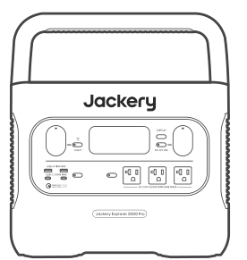

Jackery Explorer 2000 Pro

</li><li class="hb-inbox-card" data-item-number="2">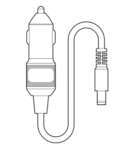

Car Charge Cable

</li><li class="hb-inbox-card" data-item-number="3">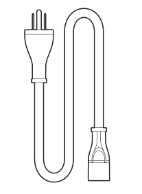

AC Charge Cable

</li><li class="hb-inbox-card" data-item-number="4">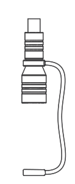

DC7909 to DC8020 Adaptor x 2

</li><li class="hb-inbox-card" data-item-number="5">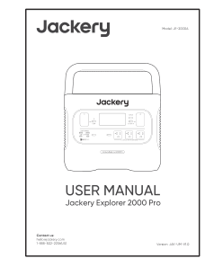

Quick Start Guide

</li></ol></figure>

## GET TO KNOW YOUR GEAR

<strong>Product Appearance</strong>

<figure class="hb-reference-figure" data-component-id="HB-SPECIAL-REFERENCE-FIGURE" data-reference-id="overview-front" data-source-fragment-sha256="7c77fba0606f712020b2181ed30cb4490b58e220bab4c08a2a0683869e4f4b52" data-step-captions="embedded">
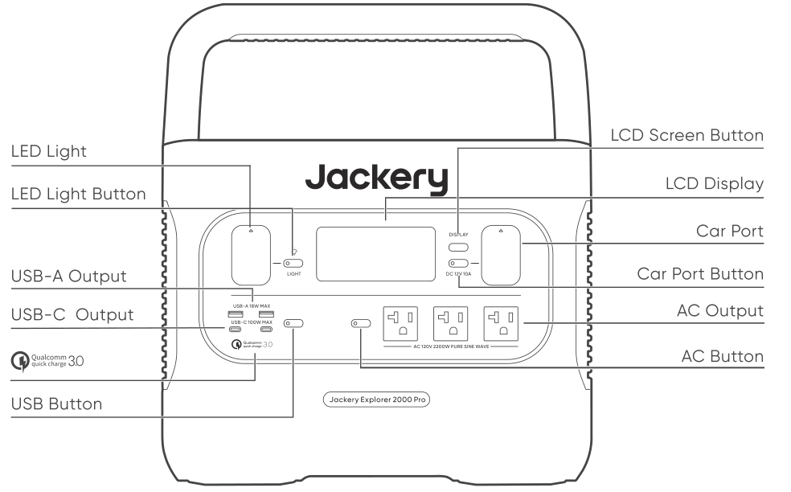
</figure>

<figure class="hb-reference-figure" data-component-id="HB-SPECIAL-REFERENCE-FIGURE" data-reference-id="overview-rear" data-source-fragment-sha256="9a57387147a210ecdaee2c9e5a1d921ad0ac4cc11f5277fb6cc3fbe8949ea4a1" data-step-captions="embedded">
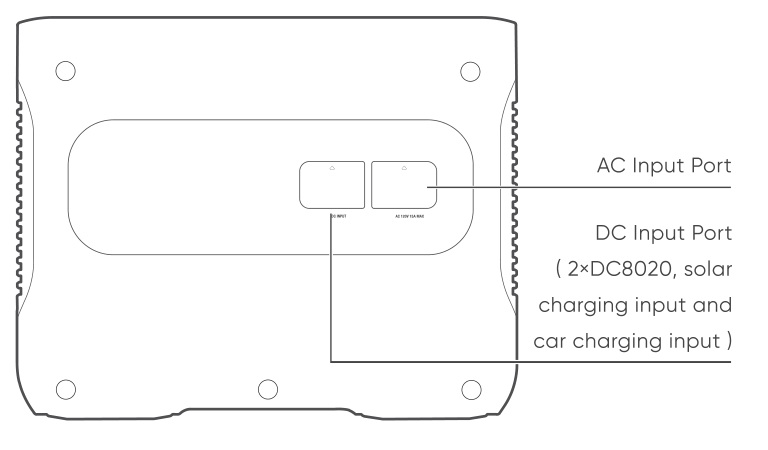
</figure>

## LCD DISPLAY

<figure class="hb-reference-figure" data-component-id="HB-SPECIAL-REFERENCE-FIGURE" data-reference-id="lcd-map" data-source-fragment-sha256="a25f42291a3413b4760c64566a59c112b3d0229d4763b1cb81a59c86b6d5830e" data-step-captions="embedded">
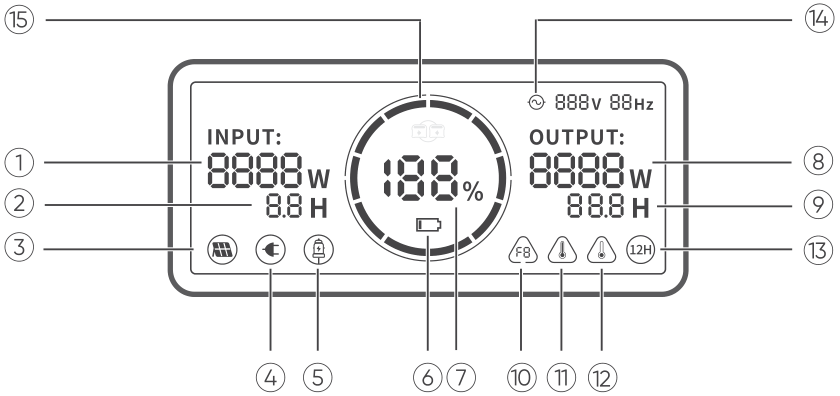
</figure>

<table class="manual-table"><tbody><tr><td>①</td><td>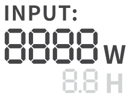</td><td>Input Power</td></tr><tr><td>②</td><td>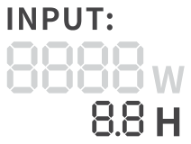</td><td>Remaining Charge Time</td></tr><tr><td>③</td><td></td><td>Solar Charging Indicator</td></tr><tr><td>④</td><td></td><td>AC Wall Charging Indicator</td></tr><tr><td>⑤</td><td>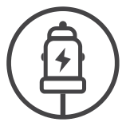</td><td>Car Charging Indicator</td></tr><tr><td>⑥</td><td></td><td>Low Battery Indicator</td></tr><tr><td>⑦</td><td></td><td>Remaining Battery Percentage</td></tr><tr><td>⑧</td><td>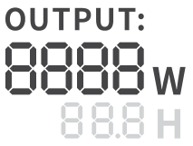</td><td>Output Power</td></tr><tr><td>⑨</td><td>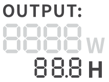</td><td>Remaining Discharge Time</td></tr><tr><td>⑩</td><td></td><td>Fault Code</td></tr><tr><td>⑪</td><td></td><td>High Temperature Warning</td></tr><tr><td>⑫</td><td></td><td>Low Temperature Warning</td></tr><tr><td>⑬</td><td></td><td>Low Power Mode</td></tr><tr><td>⑭</td><td></td><td>AC Power Indicator</td></tr><tr><td>⑮</td><td></td><td>Battery Power Indicator</td></tr></tbody></table>

<strong>Battery Power Indicator () :</strong>

When the product is being charged, the orange circle around the battery percentage will light up in sequence. When charging other devices, the orange circle will stay on.

<strong>Low Battery Indicator () :</strong>

When the battery is less than 20%, the Low Battery Indicator will stay on. When less than 5%, the Low Battery Indicator will flash. When it is being charged, the Indicator will be off.

<strong>Low Power Mode () :</strong>

To avoid forgetting to turn off the output during use that results in battery consumption, the product turns the Low Power Mode off by default. This occurs when no device is connected or the connected device is less than or equal to a certain value. (Refer to the table below for more details), the device will automatically shut down after 12 hours.

<table class="manual-table"><thead><tr><th>Output</th><th>Output Power</th><th>Defaults</th></tr></thead><tbody><tr><td>AC Output</td><td>≤25W</td><td>The device will automatically shut down after 12 hours</td></tr><tr><td>USB Output</td><td>≤2W</td><td>The device will automatically shut down after 12 hours</td></tr><tr><td>Car Output</td><td>≤2W</td><td>The device will automatically shut down after 12 hours</td></tr></tbody></table>

<strong>To turn on the Low Power Mode:</strong> Long press the AC Button and DISPLAY Button until the Low Power Mode icon lights up. In Low Power Mode, please remember to turn off the output to avoid battery consumption.

<strong>To turn off the Low Power Mode:</strong> Long press the AC Button and DISPLAY Button until the Low Power Mode icon disappears on the screen.

<strong>Fault Code () :</strong>

If the codes F0 to F9 appear on the screen, please refer to the troubleshooting guide or contact our customer service for help.

## BASIC OPERATIONS

### Power On/Off

<strong>AC Output On/Off:</strong> Press the AC Button, the AC Output operation indicator lights up. Then you can connect the equipment that needs AC charging. Press the AC Button again to turn off the AC Output.

<strong>USB Output On/Off:</strong> Press the USB Button, the USB Output operation indicator lights up. Then USB-A and USB-C Output Ports can be connected to external load devices. Press the USB Button again to turn off the USB Output.

<strong>Car Port On/Off:</strong> Press the Car Port Button, the Car Port operation indicator lights up. Then the Car Port can be connected to the external load devices. Press the Car Port Button again to turn off the output.

<figure class="hb-reference-figure" data-component-id="HB-SPECIAL-REFERENCE-FIGURE" data-reference-id="operations" data-source-fragment-sha256="c87402d35b12f7fe7b077a399dc5b77652905cb861da3aee75b022add86d847e" data-step-captions="embedded">
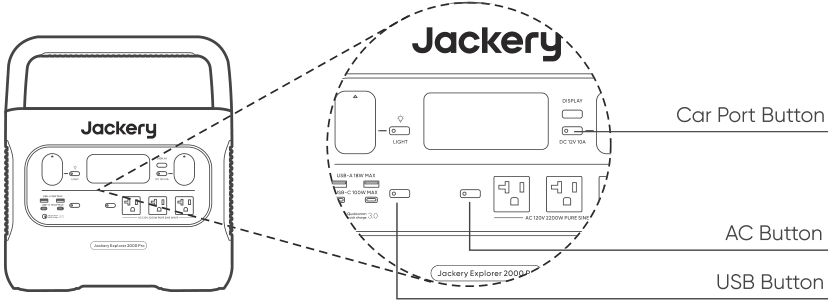
</figure>

### LCD Screen On/Off

To Turn On, press the DISPLAY Button, any Output Power Button, or LED Light Button. Or, when there’s a charging input, the screen display will light up automatically.

To Turn Off, press the DISPLAY Button again and the screen display will turn off. Or, if there is no operation in 30 seconds, the product will enter a sleep state and the screen display will automatically turn off.

<strong>To get the screen always-on (under charging or discharging state), follow these steps:</strong> After the display screen lights up, double-click the DISPLAY Button and the mode of Always-On Display will be on.

To turn off Always-On Display, follow these steps: Press the DISPLAY Button and the screen will be turned off in 30 seconds.

<table class="manual-callout-table manual-callout-table"><tbody><tr><td class="manual-callout-label">Tip</td><td class="manual-callout-body">
During Always-On mode, the screen automatically turns off after 2 hours without charging or discharging.
</td></tr></tbody></table>

### LED Light On/Off

<strong>There are three modes of LED Light:</strong> Low Light mode, Bright Light mode, and SOS mode.

<strong>The operations are as follows:</strong> Press the LED Light Button, the LED will be turned on. The light will always turn on in Low Light mode and the output power on the screen is 1W. Press again to enter the Bright Light mode and the output power on the screen is 3W. Press the third time to enter the SOS mode and the output power on the screen is 3W. Then, press again to turn off the LED Light. In any of these modes, the light can be turned off by a long press.

## CHARGING YOUR JACKERY EXPLORER 2000 PRO

<strong>Green energy first:</strong> We advocate to use the green energy first. This product supports two modes of charging at the same time: solar charging and AC wall charging.

When AC wall charging and solar charging are turned on at the same time, the product will give priority to solar charging and both methods will be used to charge the battery at the maximum permissible power.

### Charging from the wall

Please use the AC cable included in the package.

<figure class="hb-reference-figure" data-component-id="HB-SPECIAL-REFERENCE-FIGURE" data-reference-id="ac-charge" data-source-fragment-sha256="2df3911d0e7a34837149a119b8987bad143e48be3bcf38fef5c62726b7630b98" data-step-captions="embedded">
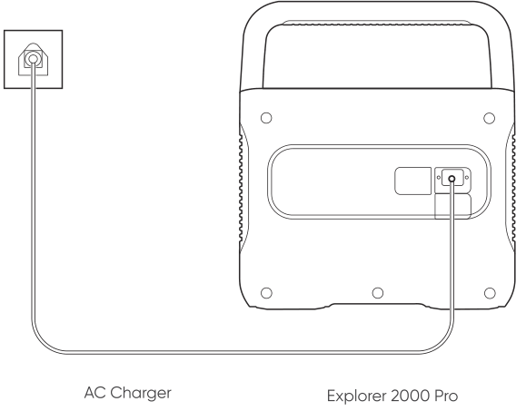
</figure>

### Charging from Solar

#### Solar Generator Connector (Tip: This accessory is sold separately)

Two or three solar panels can be connected in series through this adapter. To ensure that the solar panels can exert the maximum power output, please make sure to use the same type of solar panels when connected in series.

#### Functions of Main Ports

<figure class="hb-reference-figure" data-component-id="HB-SPECIAL-REFERENCE-FIGURE" data-reference-id="solar-connector" data-source-fragment-sha256="d60efa2927d893cb8917ef2a0a9d9254ae0b9e7174c6857d0465f2d481e4b568" data-step-captions="embedded">
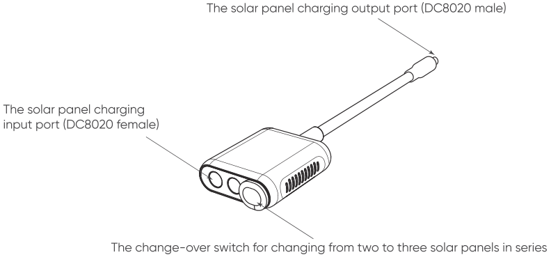
</figure>

❶ The solar panel charging output port (DC8020 male): When charging, plug this port into the DC input port of the Jackery Explorer 2000 Pro.

❷ The solar panel charging input port (DC8020 female): When charging, connect solar panel(s) to this port.

❸ The change-over switch for changing from two to three solar panels in series: When connecting two solar panels to charge, the switch should be kept OFF, otherwise it cannot be charged. If the switch is ON, three solar panels need to be connected at the same time to use it.

### How to Use (Take 200W Solar Panel As An Example)

Jackery SolarSaga solar panels (68W, 100W and 200W) are equipped with 2 port types at the output interface. Please refer to the following illustrations to connect the solar panel and the adapter.

<strong>When connecting two 200W solar panels, please operate as follows:</strong>

<figure class="hb-reference-figure" data-component-id="HB-SPECIAL-REFERENCE-FIGURE" data-reference-id="solar-two" data-source-fragment-sha256="9d7a7505e687487cef2bd540e6387faf2357bd73801a832bcc960e4d594a0e93" data-step-captions="embedded">
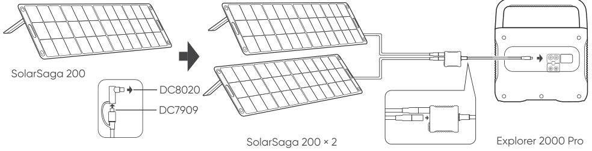
</figure>

When connecting three solar panels, please operate as follows:

<figure class="hb-reference-figure" data-component-id="HB-SPECIAL-REFERENCE-FIGURE" data-reference-id="solar-three" data-source-fragment-sha256="cff98d10075466a97bd73cc87558ff4e85296bd0d31190e47fc6ca317ad02c99" data-step-captions="embedded">
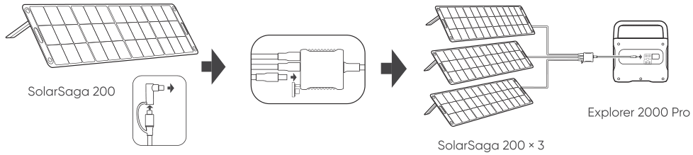
</figure>

<strong>Connection Operation Instructions:</strong> When charging, please connect the connector to the DC input port of the power station before connecting the solar panel. When the power station is fully charged, make sure to remove the solar panel first, then remove the connector from the power station.

### Solar Panels Connection Guide

Users can use our solar panels to charge this product in series or parallel as shown in the following illustrations.

#### Example 1

<figure class="hb-reference-figure" data-component-id="HB-SPECIAL-REFERENCE-FIGURE" data-reference-id="example-1" data-source-fragment-sha256="1c70741a45140405a9988847c837143b479372b6da34bdc7de7029132c944367" data-step-captions="embedded">
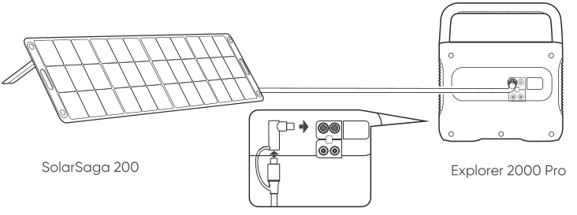
</figure>

#### Example 2

<figure class="hb-reference-figure" data-component-id="HB-SPECIAL-REFERENCE-FIGURE" data-reference-id="example-2" data-source-fragment-sha256="00a241937d21e5a6f4be3d8a8a103da236afa1f0894354b63c0c594b5438e07b" data-step-captions="embedded">
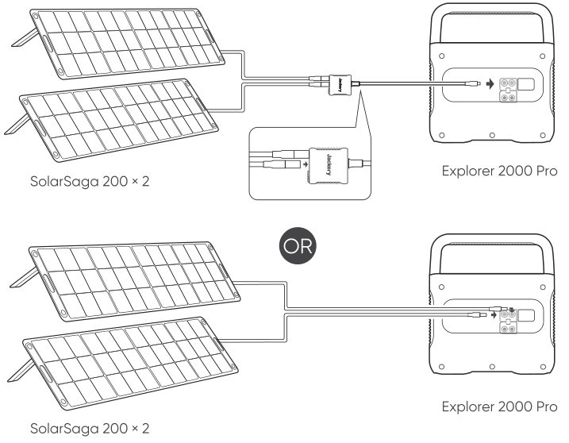
</figure>

#### Example 3

<figure class="hb-reference-figure" data-component-id="HB-SPECIAL-REFERENCE-FIGURE" data-reference-id="example-3" data-source-fragment-sha256="71fcb92bd787a39e456099331715e5afe6a11d6be939291b0abe3ecfb7b26f8e" data-step-captions="embedded">
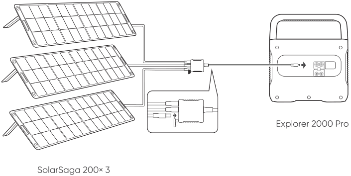
</figure>

#### Example 4

<figure class="hb-reference-figure" data-component-id="HB-SPECIAL-REFERENCE-FIGURE" data-reference-id="example-4" data-source-fragment-sha256="6103a949a8bfdcb784c76b582ac02a76c3c82e8c159dea70808aa915d23ce0b7" data-step-captions="embedded">
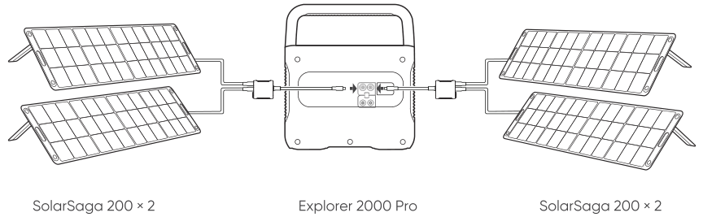
</figure>

#### Example 5

<figure class="hb-reference-figure" data-component-id="HB-SPECIAL-REFERENCE-FIGURE" data-reference-id="example-5" data-source-fragment-sha256="3f1571705aa9b3785a48edf5950ed9405646a3d1aff272ed1f1126432a72e00f" data-step-captions="embedded">
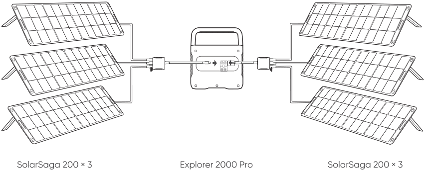
</figure>

<table class="manual-callout-table manual-callout-table"><tbody><tr><td class="manual-callout-label">Caution</td><td class="manual-callout-body">
When the two inputs are used at the same time, please make sure to use the same type of solar panel and the number of solar panels in the two inputs must be the same to avoid damage or charging problems of the equipment due to inconsistent voltages of the two channels.
</td></tr></tbody></table>

<strong>The following way of connections are prohibited to charge this product:</strong>

<figure class="hb-reference-figure" data-component-id="HB-SPECIAL-REFERENCE-FIGURE" data-reference-id="prohibited-solar" data-source-fragment-sha256="59e174723d30533ad5867518447dc3633e412d7e1f8858f66c700f7de943fb57" data-step-captions="embedded">
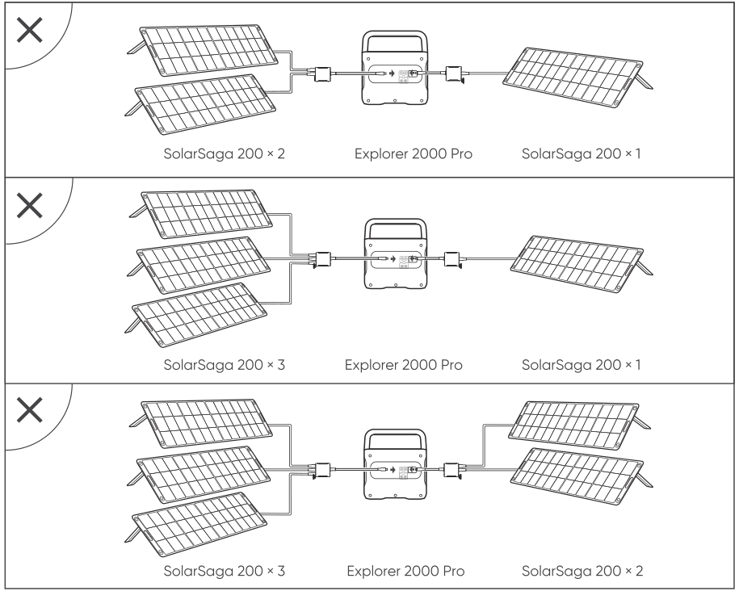
</figure>

## CHARGING IN THE CAR

This product can be charged with a 12V car charger. Please start the vehicle before charging to prevent draining the car battery and prevent your vehicle from being unable to start.

Meanwhile, please ensure that the car charger and the car cigarette lighter provide a good connection, and ensure that the car charger is fully inserted. In addition, if the vehicle is running on bumpy roads, it is forbidden to use the car charger in case it burns due to a poor connection. The Company will not be responsible for any loss caused by non-standard operation.

<figure class="hb-reference-figure" data-component-id="HB-SPECIAL-REFERENCE-FIGURE" data-reference-id="car-charge" data-source-fragment-sha256="4599f1aae28cb07a8b90bdf22d800e5715e01a86f74afb8813579bc5534eea42" data-step-captions="embedded">
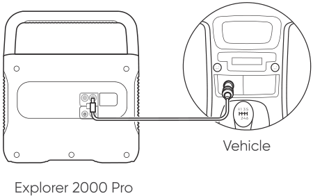
</figure>

### DC7909 to DC8020 Adaptor Operation Guide

All of our solar panels on sale have been upgraded to include a DC7909 to DC8020 adapter. If you have purchased a Jackery solar panel without a DC7909 to DC8020 adapter, you can charge your Jackery Explorer 2000 Pro by following the connection instructions below.

<figure class="hb-reference-figure" data-component-id="HB-SPECIAL-REFERENCE-FIGURE" data-reference-id="adaptor-guide" data-source-fragment-sha256="c31b285fe8779f1df4066fd9310c5079e007e013fc1696501043acf927d7f1b2" data-step-captions="embedded">
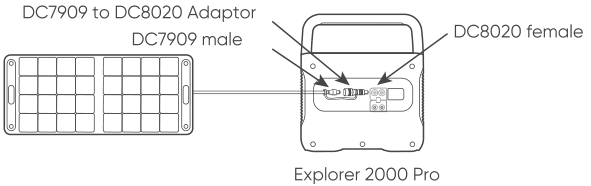
</figure>

## SAFETY PRECAUTIONS WHEN CHARGING

❶ When the two DC inputs of this product are used at the same time, please ensure that the number of solar panels connected in series is the same, and try to use the same type of solar panel.

❷ Do not charge from car charger and solar panel at the same time, otherwise, it will damage the car fuse.

<figure class="hb-reference-figure" data-component-id="HB-SPECIAL-REFERENCE-FIGURE" data-reference-id="prohibited-car-solar" data-source-fragment-sha256="c11b073baf06dc4f127422cde5b6d30552df1635fcd3d6c5af222ef6df394d27" data-step-captions="embedded">
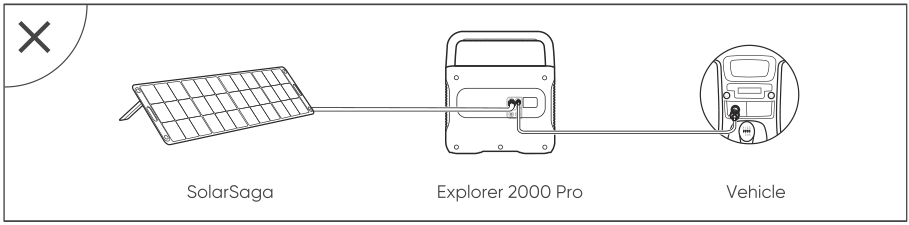
</figure>

❸ Vehicle charging is only applicable in 12V vehicles, not in 24V ones. Please do not charge this product in 24V vehicle to avoid personal injury and property loss.

❹ It is recommended to use Jackery accessories - solar panels for solar charging. We will not be responsible for the losses caused by using other brands’ solar panels.

## SAFETY PRECAUTIONS WHEN USING

<strong>The basic safety precautions should be followed when using this product, including:</strong>

a. Please read all instructions before using this product.

b. Close supervision is required when using this product near children to reduce the risk.

c. Risk of electric shock may occur if using accessories recommended or sold by non-professional product manufacturers.

d. When the product is not in use, please unplug the power plug from the product's socket.

e. Do not dismantle the product, which may lead to unpredictable risks such as fire, explosion or electric shock.

f. Do not use the product through damaged cords or plugs, or damaged output cables, which may cause electric shock.

g. Charge the product in a well ventilated area and do not restrict ventilation in any way.

h. Please put the product in a ventilated and dry place to avoid rain and water to cause electric shock.

i. Do not expose the product to fire or high temperature (under direct sunlight or in vehicle under high heat), which may cause accidents such as fire and explosion.

## INSTRUCTIONS PERTAINING TO RISK OF FIRE, ELECTRIC SHOCK, OR INJURY TO PERSONS

### IMPORTANT SAFETY INSTRUCTIONS

WARNING–When using this product, basic precautions should always be followed, including the following:

a) Read all the instructions before using the product.

b) To reduce the risk of injury, close supervision is necessary when the product is used near children.

c) Do not put fingers or hands into the product.

d) Use of an attachment not recommended or sold by power pack manufacturer may result in a risk of fire, electric shock, or injury to persons.

e) To reduce risk of damage to the electric plug and cord, pull the plug rather than the cord when disconnecting the power pack.

f) Do not use a battery pack or appliance that is damaged or modified. Damaged or modified batteries may exhibit unpredictable behavior resulting in fire, explosion or risk of injury.

g) Do not operate the power pack with a damaged cord or plug, or a damaged output cable.

h) Do not disassemble the power pack, take it to a qualified service person when service or repair is required. Incorrect reassembly may result in a risk of fire or electric shock.

i) To reduce the risk of electric shock, unplug the power pack from the outlet before attempting any instructed servicing.

j) PERSONAL PRECAUTIONS

1) Have plenty of fresh water and soap nearby in case battery acid contacts skin, clothing, or eyes.

2) Wear complete eye protection and clothing protection. Avoid touching eyes while working near battery.

3) If battery acid contacts skin or clothing, wash immediately with soap and water. If acid enters eye, immediately flood eye with running cold water for at least 10 minutes and get medical attention immediately.

4) NEVER smoke or allow a spark or flame in vicinity of battery or engine.

5) Be extra cautious to reduce risk of dropping a metal tool onto battery. It might spark or short-circuit battery or other electrical part that may cause explosion.

k) When charging the internal battery, work in a well-ventilated area and do not restrict ventilation in any way.

l) Under abusive conditions, liquid may be ejected from the battery; avoid contact. If contact accidentally occurs, flush with water. If liquid contacts eyes, additionally seek medical help. Liquid ejected from the battery may cause irritation or burns.

m) Do not expose a power pack to fire or excessive temperature. Exposure to fire or temperature above 130°C may cause explosion. The temperature of 130°C can be replaced by the temperature of 265°F.

n) Have servicing performed by a qualified repair person using only identical replacement parts. This will ensure that the safety of the product is maintained.

### SAVE THESE INSTRUCTIONS OPERATING INSTRUCTIONS

<ul><li>
Use and store the unit only in a clean and dry environment. DO NOT use and store in dusty and wet environment.
</li><li>
Check the unit prior to every use. DO NOT use the unit if it is damaged, broken.
</li><li>
If rust, peculiar odors, overheating or other abnormal circumstances are observed, stop using the unit immediately and contact the dealer or our customer service center.
</li><li>
Make sure that the unit is properly secured when transporting it in a motor vehicle.
</li><li>
Only charge, use and store the unit within an ambient temperature of 0°C to 40°C (32°F ~ 104°F) .
</li><li>
Switch the unit off immediately if it has accidentally fallen, was dropped or was exposed to vibrations.
</li><li>
DO NOT use the unit if the power cord is damaged or broken.
</li><li>
Keep the unit away from children. DO NOT let children use the power supply unit. Keep this product away from pets.
</li><li>
DO NOT use the unit in an area or environment with high temperature.
</li><li>
Should fluid from inside of the unit come in contact with your skin or clothing, wash the affected areas with tap water.
</li><li>
In a storm, unplug the power cord from the socket.
</li><li>
DO NOT charge the unit via power supply systems that operate outside of 100-240V.
</li><li>
DO NOT place the unit on its side or upside down while in use or storage.
</li><li>
DO NOT use accessories for other usage.
</li><li>
Make sure that the device you are connecting is switched off before you connect it.
</li><li>
DO NOT expose a power pack to fire or excessive temperature. Exposure to fire or temperature above 130°C may cause explosion.
</li><li>
Solar charge times depend on weather conditions, place your solar panel where it will get as much direct sunlight as possible.
</li><li>
DO NOT place the power pack on the floor, or at a height less than 457 mm (18 inches) above the floor, during use in a repair facility.
</li></ul>

<table class="manual-callout-table manual-callout-table"><tbody><tr><td class="manual-callout-label">WARNING</td><td class="manual-callout-body">
Do not remove the battery pack without permission. If you need to repair the battery pack, contact your local manufacturer as soon as possible
</td></tr></tbody></table>

<table class="manual-callout-table manual-callout-table"><tbody><tr><td class="manual-callout-label">DANGER</td><td class="manual-callout-body">
This device is intended to be used indoors only. Do not use outdoors under any conditions.
</td></tr></tbody></table>

### Charging instruction

1. The product supports any 1 way or 2 way charging.

2. Charge the Portable Power Station with charger; the LCD will turn on and display Input power

3. Display will show 100% capacity when fully charged.

### Discharging instruction

1. Press the AC button, AC output will be turn on; and press the button again, the AC output will turn off， while the AC LED will turn off within 1~2seconds.

2. Press the any 1 or 2 way DC (USB or 12V) button, output will be turn on; and press the button again, the DC output will turn off， while the DC LED will turn off within 1~2 seconds.

3. If DC or AC output is on LCD will display “OUPUT” icon and output power unless all DC output is off.

### MOVIN AND STORAGE INSTRUCTIONS

<ul><li>
DO NOT move the unit if it is recharging or in use.
</li><li>
DO NOT dispose the unit together with household waste.
</li><li>
DO NOT place the unit close to or in a fire or expose it to heat. Keep out of direct sunlight.
</li><li>
DO NOT store the unit in a bathroom or in an area exposed to rain or moisture.
</li><li>
DO NOT disassemble the power pack, take it to a qualified service person when service or repair is required. Incorrect reassembly may result in a risk of fire or electric shock.
</li><li>
DO NOT store the unit in an area or environment with high temperature.
</li></ul>

### USER MAINTENANCE INSTRUCTIONS

<ul><li>
Before using or storing, plug your Jackery Explorer into the wall until it is fully charged. If you see the LCD battery is low at any point, plug it into a power source, like an AC outlet or a solar panel as soon as possible.
</li><li>
To preserve the battery lifespan, please use and recharge at least once every 6 months.
</li></ul>

## FAQ

<strong>Q: Can the product be brought on board a plane?</strong>

A: No, because this product is a lithium battery. According to the International Standards &amp; Regulations for the Transportation of Hazardous Materials, no lithium batteries with more than 100 watt hours may be allowed in carry-on bags.

<strong>Q: Why is there sound when using?</strong>

A: The product adopts an air-cooled system, and the built-in fan helps the product to cool better. Slight noise when using is normal.

<strong>Q: Can I charge the Jackery Explorer 2000 Pro while a device is plugged in?</strong>

A: Yes, you can. When charged with AC input, it supports a maximum power output of 1800W. When charged with AC input + DC input ( i.e. solar charging or car charging) simultaneously - it supports a maximum power output of 1800W. When charged with DC input (i.e. solar charging or car charging), it supports a maximum power output of 2200W.

<strong>Q: How to keep this product when it is not used for a long time?</strong>

A: If the battery is to be unused for a long time (more than 3 months), it should be maintained at 60-80% of the rated capacity (it's recommended to check and charge every 3 months). Store it in a dry and cool place with temperature range between 0°C~40°C, and humidity 0%~60%. Avoid contact with corrosive substances, and far from fire and heat sources.

<strong>Q: Can it be used to jump start a car?</strong>

A: We are very sorry, but it cannot be used to jump start a vehicle. However, it can be used as power supply for automobiles. You can recharge the car via a Jackery power supply cord, which is available for purchase separately.

<strong>Q: Why is the output to the low-power device automatically turned off after several hours?</strong>

A: In case of forgetting to turn off the output (causing the battery to drain), the Low Power Mode will be turned off by default. That is, when the port is connected to a small load device(AC Output≤25W, USB Output≤2W, Car Port≤2W) for 12 hours, the device will automatically be turned off. In case you want to resume recharging, press the car port button/USB button/AC button to restart the device. If you want to turn on the Low Power Mode, long press the AC Button and DISPLAY until the Low Power Mode icon  appears on the screen. If you need to turn off the Low Power Mode, repeat the above operation until  .

<strong>Q: Why does the USB Output operation indicator light up, the load device has no charging input or can't work normally?</strong>

A: Please check whether the load device is broken firstly. If the device is normal, press the USB Button to restart the output.

## TROUBLESHOOTING

<table class="manual-table"><thead><tr><th>Errors</th><th>Types</th><th>Solutions</th></tr></thead><tbody><tr><td rowspan="10">Error Code (F0-F9)</td><td>
 BMS communication failure
</td><td>Contact after-sales service</td></tr><tr><td>
 inverter communication failure
</td><td>Contact after-sales service</td></tr><tr><td>
 charging module communication failure
</td><td>Contact after-sales service</td></tr><tr><td>
 battery failure
</td><td>Contact after-sales service</td></tr><tr><td>
 battery over-voltage
</td><td>Contact after-sales service</td></tr><tr><td>
 battery under-voltage
</td><td>Contact after-sales service</td></tr><tr><td>
 inverter error
</td><td>Contact after-sales service</td></tr><tr><td>
 charging module error
</td><td>Contact after-sales service</td></tr><tr><td>
 Overcurrent/short circuit charging or discharging protection
</td><td>Resolve the problem by pulling out plug or electrical appliances, the product can recover itself. If not solved, please contact our after-sales service.</td></tr><tr><td>
 DC output overcurrent/short circuit protection
</td><td>Resume operation by pulling out electrical appliances, the product can recover itself. If not solved, please contact our after-sales service.</td></tr><tr><td></td><td>High temperature warning</td><td>The product can recover itself after battery is cooled</td></tr><tr><td></td><td>Low temperature warning</td><td>The product can recover itself after the ambient temperature increases</td></tr></tbody></table>

## WARRANTY

<strong>Note: We only provide our warranty for the buyer who purchased on Amazon (Jackery Inc.), Jackery website or local authorized dealers.</strong>

### Limited Warranty

<figure aria-label="Limited Warranty" class="hb-warranty-card" data-component-id="HB-WARRANTY-SECTION" data-warranty-card-index="1">
Jackery Inc. warrants to the original consumer purchaser that the Jackery product will be free from defects in workmanship and material under normal consumer use during the applicable warranty period identified in the 'Warranty Period' section below, subject to the exclusions set forth below.

This warranty statement sets forth Jackery's total and exclusive warranty obligation. We will not assume, nor authorize any person to assume for us, any other liability in connection with the sale of our products.
</figure>

### Warranty Period

<figure aria-label="Warranty Period" class="hb-warranty-card" data-component-id="HB-WARRANTY-SECTION" data-warranty-card-index="2">
The warranty period for Jackery power products is 36 months. In each case, the warranty period is measured starting on the date of purchase by the original consumer purchaser. The sales receipt from the first consumer purchase, or other reasonable documentary proof, is required in order to establish the start date of the warranty period.
</figure>

### Exchange

<figure aria-label="Exchange" class="hb-warranty-card" data-component-id="HB-WARRANTY-SECTION" data-warranty-card-index="3">
Jackery will replace (at Jackery's expense) any Jackery product that fails to operate during the applicablewarranty period due to defect in workmanship or material. A replacement product assumes the remaining warranty of the original product.
</figure>

### Limited to Original Consumer Buyer

<figure aria-label="Limited to Original Consumer Buyer" class="hb-warranty-card" data-component-id="HB-WARRANTY-SECTION" data-warranty-card-index="4">
The warranty on Jackery's product is limited to the original consumer purchaser and is not transferable to any subsequent owner.
</figure>

### Jackery Inc.

© Copyright 2012-2022 Jackery Inc. All trademarks cited herein are the property of their respective owners.

The only warranties for Jackery products and services are set forth in the warranty statements accompanying such products and services. Jackery shall not be liable for technical or editorial errors or omissions contained herein.

First Edition: January 2022. Document Part Number: J2000P-UM-001. This user guide describes features that are common to most models.

